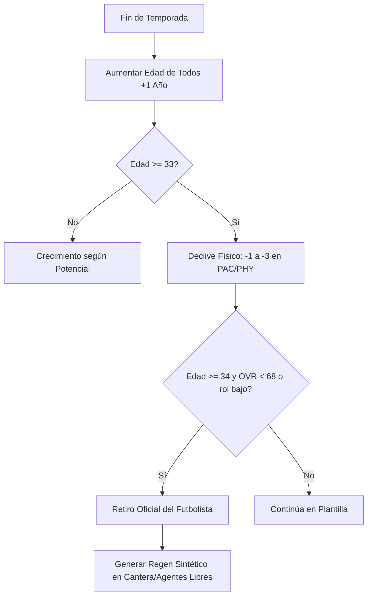

# 📋 SPEC 004: Carrera de 25 Temporadas, Envejecimiento y Regens

- **Estado:** Aprobado / MVP
- **Responsables:** `squad-academy` & `gameplay-engine`
- **Módulos Afectados:** `js/types.ts`, `js/data/db.ts`, `js/engine/youthAcademy.ts`, `js/engine/playerForm.ts`

---

## 1. Objetivo y Visión

Garantizar la longevidad del juego a lo largo de un ciclo completo de **25 temporadas** (desde 2025/2026 hasta 2050/2051). El entrenador envejece de novato de 35 años a leyenda consagrada de 70 años, mientras el universo de jugadores se renueva a través de 3 a 4 generaciones de futbolistas sintéticos y regens.

## 2. Ciclo Anual de Envejecimiento y Retiro

## 3. Lógica del Sistema de Regens

1. **Atributos Heredados**:
   - Mantiene la **nacionalidad**, **posición principal** y **potencial máximo** original del jugador legendario retirado.
   - Nuevo nombre procedural generado por el diccionario regional (`REGIONAL_NAMES`).
   - Nueva edad asignada entre **16 y 18 años**.
   - OVR inicial calibrado entre **60 y 72** para permitir desarrollo orgánico.
2. **Distribución en el Ecosistema**:
   - El 40% de los regens ingresa a la agencia libre del país de origen.
   - El 60% se asigna a las academias juveniles de clubes de la liga donde se retiró la estrella.

## 4. Límite de Carrera del DT

- **Edad Inicial**: 35 años (Novato).
- **Edad Máxima**: 70 años (25 temporadas exactas).
- **Final de Trayectoria**: En la semana 52 de la temporada 25, se despliega la pantalla de condecoración en el Salón de la Fama y resumen estadístico histórico de toda la carrera profesional.
