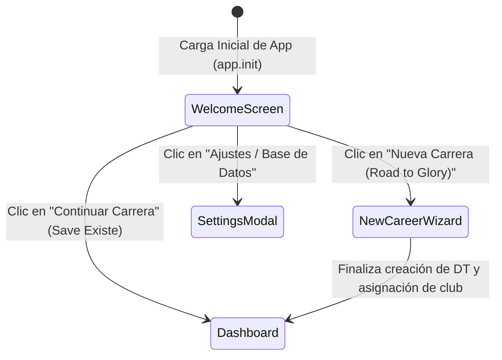

# 📋 SPEC 005: Pantalla de Bienvenida Inicial y Flujo de Entrada Retro (PES 6 / FIFA 08)

- **Estado:** Aprobado / MVP
- **Responsables:** `pixel-ui-designer` & `Tech Lead`
- **Módulos Afectados:** `js/ui/welcomeUI.ts`, `js/app.ts`, `js/ui/newCareerUI.ts`, `css/main.css`

---

## 1. Objetivo y Visión de Experiencia (UX)

Proporcionar una pantalla inicial de bienvenida con la estética e impacto visual de los clásicos del fútbol (**Pro Evolution Soccer 6** y **FIFA 06-08**):
- **Identidad Broadcast Retro**: Tipografía de alto contraste (*Outfit* y *Inter*), tonalidades oscuras con acentos esmeralda y cian, atmósfera de túnel de vestuarios y estadio nocturno.
- **Flujo de Acceso Inmediato**:
  - `CONTINUAR CARRERA`: Disponible inmediatamente si existe un save válido en `localStorage`, mostrando club actual, temporada (1 a 25), semana y saldo económico.
  - `NUEVA CARRERA (ROAD TO GLORY)`: Acceso directo al asistente de creación de DT novato comenzando en las divisiones de barro de los 5 pilares europeos.
  - `CONFIGURACIÓN & BASE DE DATOS`: Visualización de versiones (Temporada 2025/2026), exportar/importar partida y créditos.
- **Responsive**: Ajuste fluido para móvil, tablet y escritorio en Vercel.

---

## 2. Diagrama de Estados de Navegación Inicial

---

## 3. Elementos de la Pantalla Inicial (`welcomeUI.ts`)

1. **Header / Logo**:
   - Título principal: `ENTRENADOR LEYENDA`.
   - Subtítulo dinámico: `Simulador Profesional de Carrera DT • Temporadas 2026 - 2051`.
   - Badge distintivo: `EDICIÓN ROAD TO GLORY • 25 AÑOS DE TRAYECTORIA`.
2. **Tarjeta de Partida Activa (si existe `db.gameState`)**:
   - Escudo del club dirigido.
   - Nombre del DT, edad, temporada y semana de competición.
   - Posición en liga y presupuesto disponible.
   - Botón de acción principal: `CONTINUAR TEMPORADA [▶]`.
3. **Pilar de Inicio "Road to Glory"**:
   - Tarjeta interactiva destacando el desafío de ascender desde la 5ª división hasta la Champions League.
   - Botón: `COMENZAR NUEVA CARRERA [+`.
4. **Selector Rápido de Información**:
   - Resumen de los 5 pilares europeos (🏴󠁧󠁢󠁥󠁮󠁧󠁿 National League, 🇪🇸 Tercera RFEF, 🇮🇹 Serie C, 🇩🇪 3. Liga, 🇫🇷 National).
   - Acceso al modal de administración de datos (exportar JSON, importar JSON, reiniciar).

---

## 4. Casos de Prueba (Criterios de Aceptación)

- [ ] Si existe partida guardada, el botón "Continuar Carrera" aparece en primer plano con los datos del club.
- [ ] Si no existe partida, el foco automático está en "Nueva Carrera (Road to Glory)".
- [ ] La interfaz se adapta correctamente tanto en pantallas móviles (< 600px) como en pantallas ultra-wide (> 1200px).
- [ ] Cero uso de emojis en los componentes; uso estricto de iconos SVG vectoriales o insignias tipográficas.
