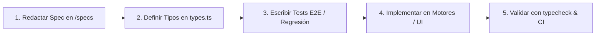

# 📐 Spec-Driven Development (SDD) — Entrenador Leyenda

Bienvenido al marco de **Desarrollo Guiado por Especificaciones (Spec-Driven Development)** de *Entrenador Leyenda*.

## 🔄 El Flujo SDD

Cada nueva característica o refactorización del juego sigue 4 pasos obligatorios antes de fusionarse a `main`:

1. **Especificación (`/specs/XXX-nombre.md`)**:
   - Resumen del requerimiento y valor para el jugador.
   - Contratos de datos (interfaces, tipos, enums).
   - Invariantes matemáticas y reglas de negocio.
   - Matriz de casos de prueba y estados límite.
2. **Contratos en `types.ts`**:
   - Se añaden o actualizan las interfaces como fuente única de verdad sin dependencias circulares.
3. **Implementación por Agente Especialista**:
   - Cada subagente toma su especificación y programa únicamente lo requerido respetando las restricciones de rendimiento (60 FPS, Canvas 2D, memoria ligera).
4. **Validación**:
   - `npm run typecheck` (`tsc --noEmit`).
   - `npm run test:e2e` (Playwright).
   - Actualización de `memory.md` y commit de Git.

---

## 🤖 Directorio de Agentes del Proyecto

| Agente | Rol | Especialidad / Módulos Asignados |
| :--- | :--- | :--- |
| **`Tech Lead` (Coordinador)** | Arquitectura & SDD | Orquestación, revisión de código, git workflow, CI y balance global. |
| **`gameplay-engine`** | Gameplay & Balística | `matchEngine.ts`, `ballPhysics`, `teamSpirit.ts`, simulación multi-liga PES 6. |
| **`transfers-economy`** | Finanzas & Fichajes | `transfers.ts`, techos OVR/POT por tier, préstamos y gacha de ventajas. |
| **`squad-academy`** | Plantilla & Carrera | `youthAcademy.ts`, `playerForm.ts`, 25 temporadas, envejecimiento y regens. |
| **`pixel-ui-designer`** | UI & Pixel Art | `isometricPitch.ts`, spritesheets 48x48, canvas por capas, HUD retro broadcast. |

---

## 📂 Índice de Especificaciones Activas

- [**`001-league-pyramids-and-tiers.md`**](file:///d:/JotaDev/Juegos%20HTML/Entrenador%20leyenda/Modo%20Manager%20DT/specs/001-league-pyramids-and-tiers.md): Los 5 pilares europeos y la integración de la 5ª división (National League, etc.).
- [**`002-transfer-restrictions.md`**](file:///d:/JotaDev/Juegos%20HTML/Entrenador%20leyenda/Modo%20Manager%20DT/specs/002-transfer-restrictions.md): Restricción de fichajes por tier de liga (topes OVR/POT).
- [**`003-scouting-gacha-perks.md`**](file:///d:/JotaDev/Juegos%20HTML/Entrenador%20leyenda/Modo%20Manager%20DT/specs/003-scouting-gacha-perks.md): Sistema de paquetes de ojeo y cartas de ventaja táctica/administrativa.
- [**`004-career-25-seasons-regens.md`**](file:///d:/JotaDev/Juegos%20HTML/Entrenador%20leyenda/Modo%20Manager%20DT/specs/004-career-25-seasons-regens.md): Lógica de 25 temporadas, envejecimiento del DT (35 a 70) y cantera de regens.
